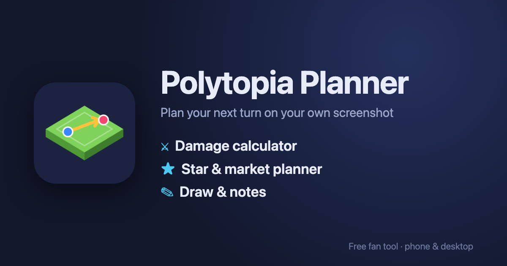

# Polytopia Planner

A free fan tool for **The Battle of Polytopia** – plan your next turn right on your own screenshot.

**Live: [polytopiaplanner.com](https://polytopiaplanner.com)** – works on phone and desktop, no account, no install.



## Features

- ⚔️ **Damage calculator** – place units on your screenshot and simulate fights (HP, veteran, defense bonus);
  all 55 units incl. ships and the special tribes (Aquarion, ∑∫ỹriȱŋ, Polaris, Cymanti) with their skills
  (splash, explode, poison, freeze, convert, tentacles, …)
- ⭐ **Star & market planner** – budget your stars and optimize market purchases
- ✏️ **Draw & notes** – arrows, markings and notes on top of the map
- Automatic grid detection and text recognition (OCR) run in the browser – screenshots stay on your device
  (unless you opt into the optional AI detection with your own Anthropic API key)

## Run it locally

It's a plain static web app (HTML/CSS/JavaScript, no build step, no dependencies).

```sh
python3 serve.py          # http://localhost:8000 – also prints your LAN address for testing on a phone
```

## Project structure

| Path | What |
|---|---|
| `index.html`, `css/`, `js/` | the app (`js/main.js` is the entry point) |
| `icons/`, `og-image.png` | app icons (own artwork) |
| `vendor/tesseract/` | self-hosted Tesseract.js for OCR (Apache-2.0) |
| `docs/` | design notes / specs from development |
| `release.sh` | copies the files the website needs into `dist/` |
| `deploy.sh` | uploads `dist/` to a server via SSH (needs `deploy.env`, see `deploy.env.example`) |

## Contributing

Bug reports, ideas and pull requests are welcome – please open an [issue](../../issues).

## License

[MIT](LICENSE) © Ole Reuter. Third-party code in `vendor/` keeps its own license.

*Polytopia Planner is an unofficial fan project and is not affiliated with or endorsed by Midjiwan AB.
"The Battle of Polytopia" is a trademark of Midjiwan AB.*
